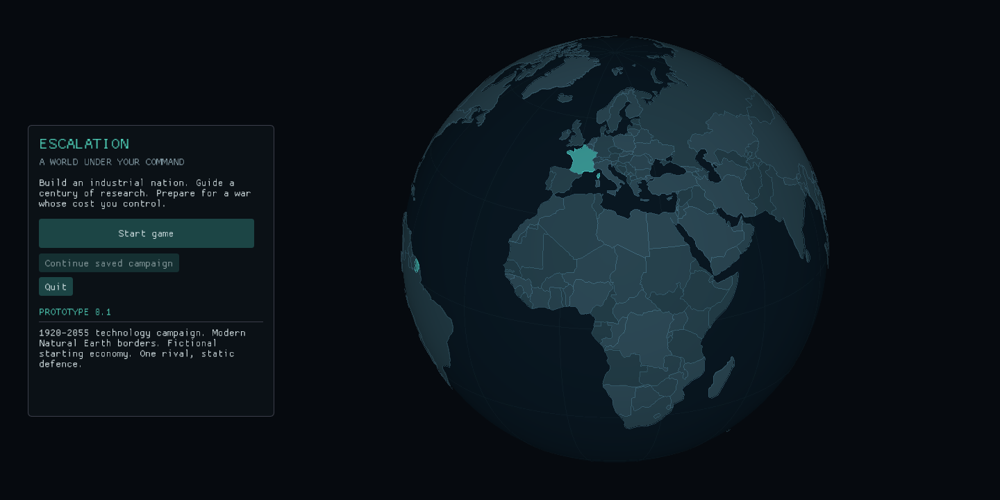
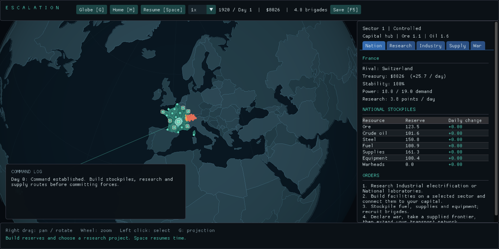
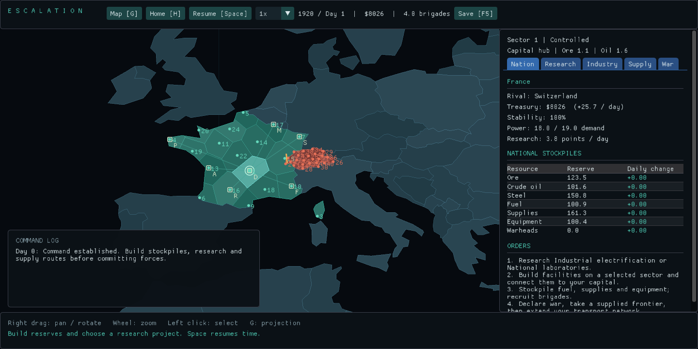
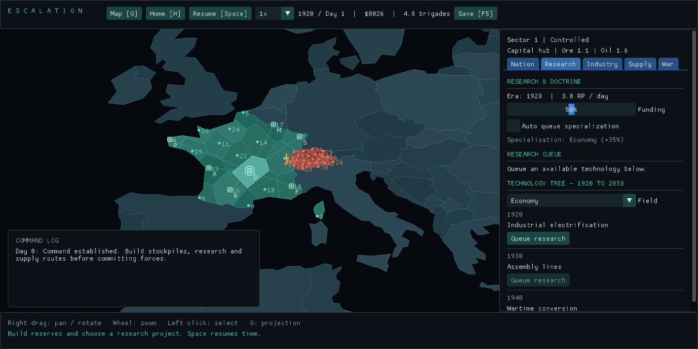
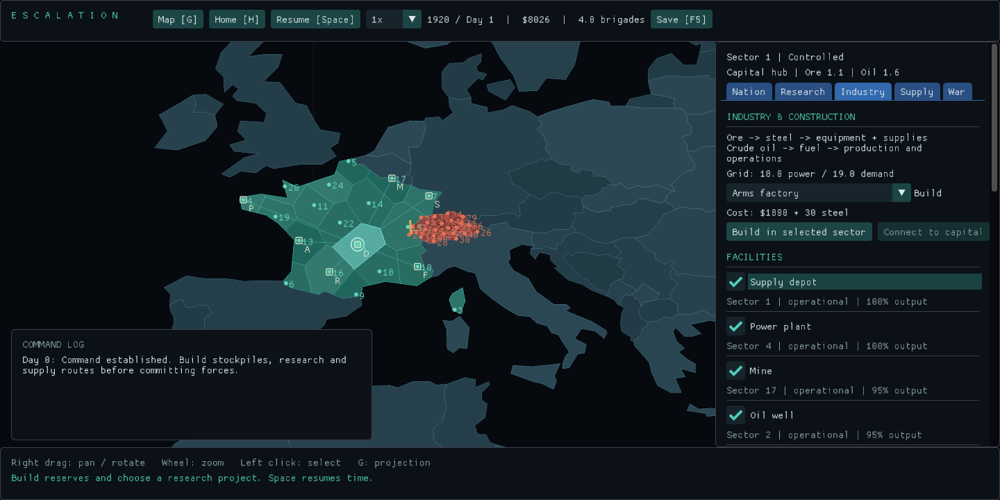

# Native application screenshots

Captured from the running OpenGL application using its Linux EGL smoke mode. These are functional UI screens, not design mockups.

## Main menu

## Globe and national command

## Flat map and subregions

## Research

## Industry

