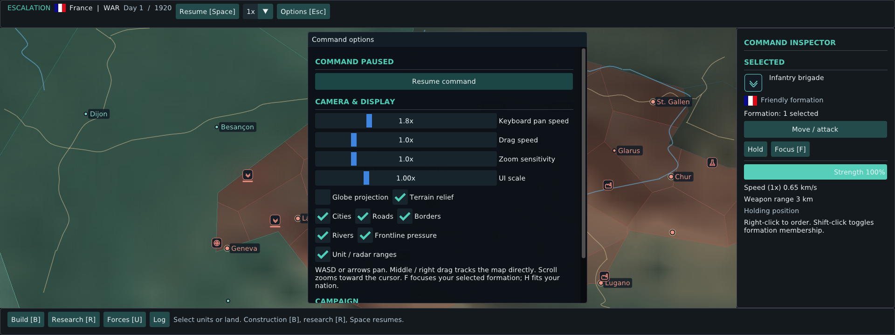
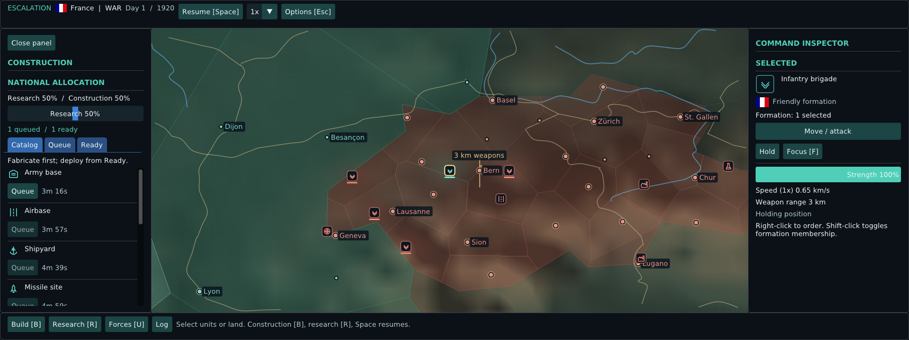
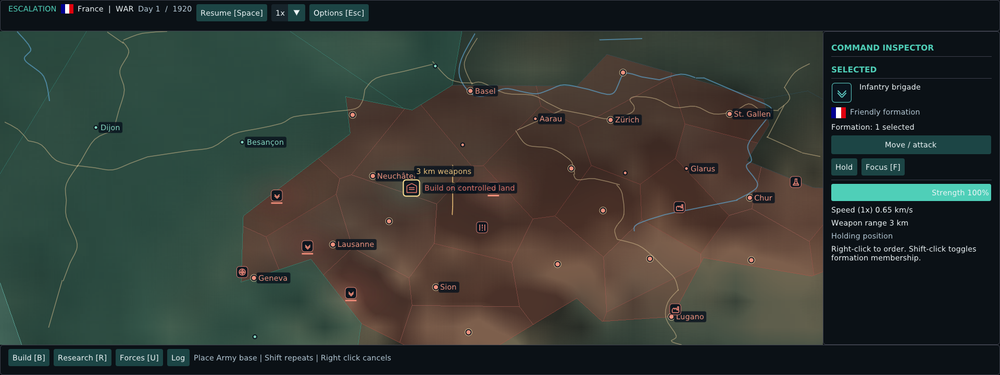

# Native application screenshots

Captured from the running version-0.4 OpenGL application using Linux EGL smoke mode. These are functional UI screens, not mockups.

## Main menu

## Select a nation on the map

## Globe command

## Map-first HUD and visible forces

## Branching research canvas

## Fabrication catalog

## Regional settlement control

## Forces and strategic weapons

## Docked unit command at 64× zoom

## Imported roads, cities and dynamic frontline

## Pause and display options

## Fabrication queue and ready inventory counts

## Ready building placement preview

Screens were captured from the native client at 1920×1080; the 1280×720, 125% scale layout was also rendered and inspected.
