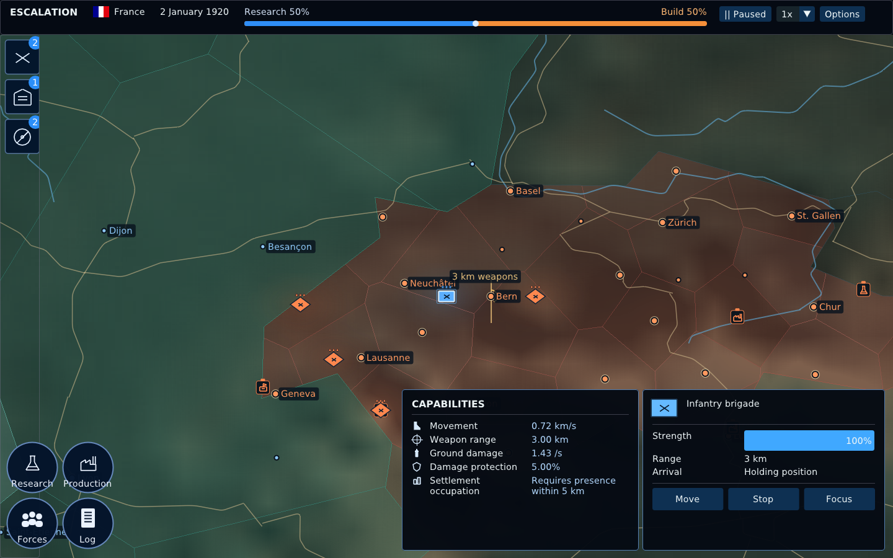

# Native application screenshots

The current research, production, capabilities/inspection and options captures come from the running version-0.6.0 OpenGL application at 1440×900. The remaining images document earlier game surfaces. These are native renders, not concept images.

## Main menu

## Select a nation on the map

## Globe command

## Map-first HUD and visible forces

## Branching research canvas

## Fabrication catalog

## Regional settlement control

## Forces and strategic weapons

## Docked unit command at 64× zoom

## Imported roads, cities and dynamic frontline

## Pause and display options

## Fabrication queue and ready inventory counts

## Ready building placement preview

Screens were captured from the native client at 1920×1080; the 1280×720, 125% scale layout was also rendered and inspected.

The 0.5.0 unit inspector and options captures use 1280×720 at 125% manual UI scale to show the corrected horizontal dock, allocation bar and scale controls. Older captures illustrate the preceding command surfaces.

## Approved Concept A: capability and selection boxes

A 1280×720 render at 125% manual scale was also reviewed for the compact header, circular controls and paired boxes. Research keeps a readable font floor and pans when a mature tree exceeds the viewport.
