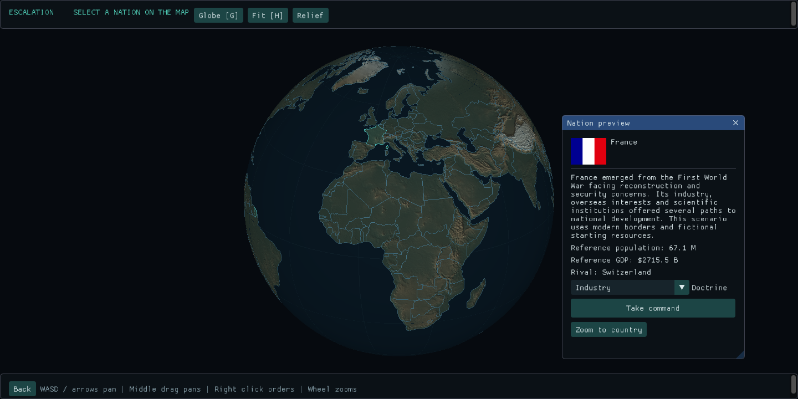
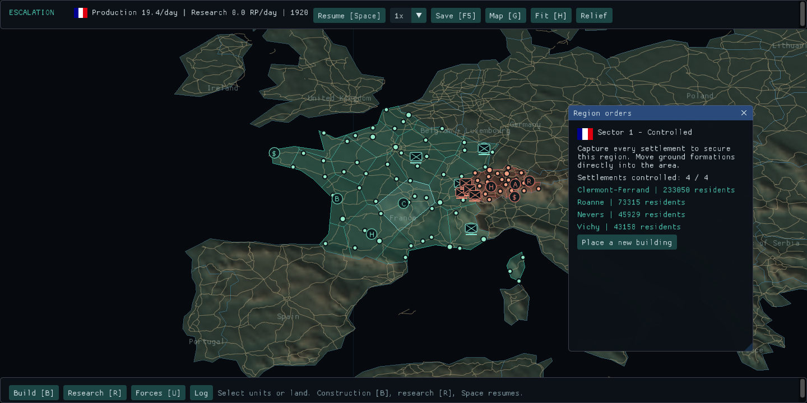
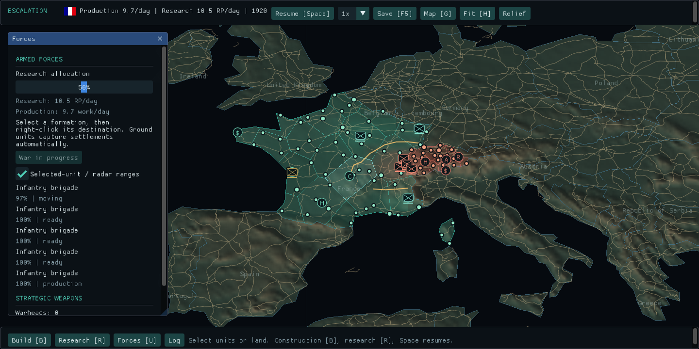
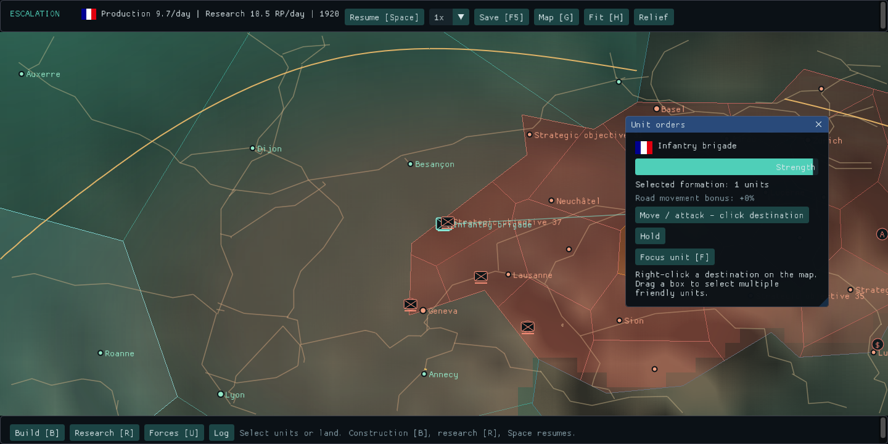
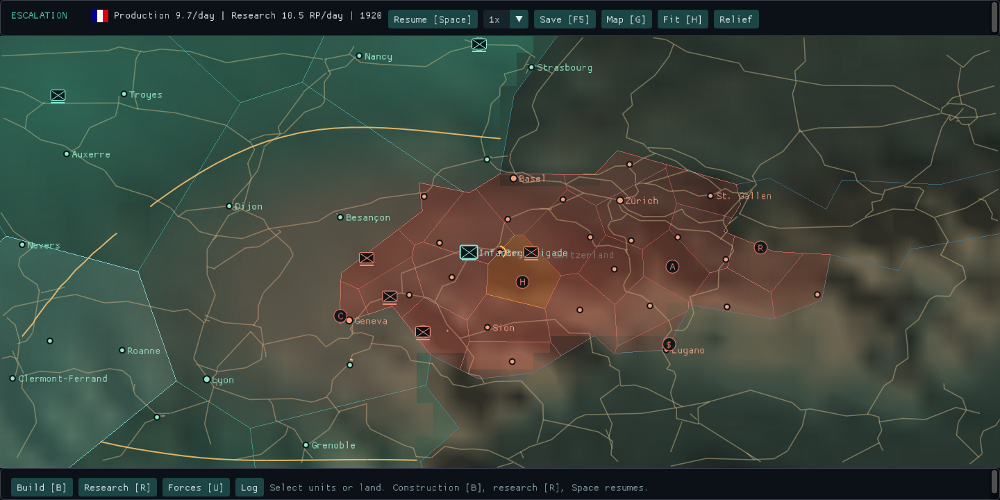

# Native application screenshots

Captured from the running version-0.3 OpenGL application using Linux EGL smoke mode. These are functional UI screens, not mockups.

## Main menu

## Select a nation on the map

## Globe command

## Map-first HUD and visible forces

## Connected research tree

## Map construction catalogue

## Regional settlement control

## Forces and strategic weapons

## Close-up unit command at 64× zoom

## Imported roads, cities and dynamic frontline

